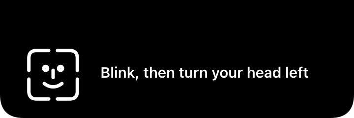

# 2D-Face-ID: `faceauth`

A learning project: a command-line tool that enrolls your face with the MacBook's
webcam, then checks it again with liveness checks. While it works, it shows a
notch-style overlay at the top of the screen. Milestone 2 lets `sudo` accept your face,
and your password still works as a fallback.

> **This is weaker than your password, Touch ID or Face ID.** Read
> [Security limitations](#security-limitations) before you install it for `sudo`.
> It does not touch the login window, the lock screen or FileVault.

The full contract (requirements, decisions, verification results) is in [SPEC.md](SPEC.md).

## How it works

1. **Camera:** AVFoundation reads 640×480 frames from the built-in camera. Frames
   stay in memory and are never written to disk.
2. **Face detection:** Vision finds faces (`VNDetectFaceRectanglesRequest`, with
   yaw and pitch), landmarks (`VNDetectFaceLandmarksRequest`) and capture quality.
   A frame with no face, or with more than one face, is never used.
3. **Alignment:** the two eye centres are mapped onto the standard ArcFace
   112×112 template with a similarity transform.
4. **Embedding:** MobileFaceNet, converted to Core ML, turns the aligned crop into
   a 128-number vector. Two faces are compared with cosine similarity.
5. **Liveness:** `verify` passes only when the same face track, within 5 s,
   - **blinks**: the eye aspect ratio (EAR) drops and recovers within 1–8 frames,
     as in Soukupová & Čech 2016;
   - **turns its head** in a direction picked at random for each attempt, held for
     3 frames at 20° or more; turning the wrong way fails at once;
   - **moves non-rigidly**: landmarks are normalised to the eye line, so sliding,
     rotating in-plane or zooming a flat photo does not count. Tilting a photo
     away from the camera (perspective) is *not* cancelled and may count;
   - **matches**: the mean of at least 3 frontal embeddings, compared with your
     enrollment, reaches the threshold.

   If a second face appears, or the face track is lost, all progress starts over.

## Setup

You need macOS 14 or later and Swift 5.9 or later. The Command Line Tools are enough.

```bash
# 1. Build (use release: the model then runs in ~3 ms per frame)
swift build -c release

# 2. Download and convert the face model (once; about 300 MB of Python packages)
python3 -m venv scripts/.venv
scripts/.venv/bin/pip install -r scripts/requirements.txt
scripts/.venv/bin/python -I scripts/convert_model.py

# 3. Check that the model loads (no camera)
.build/release/faceauth self-test
```

### Model

| | |
|---|---|
| Model | MobileFaceNet (trained with an ArcFace loss), 128-d embeddings |
| Source | https://github.com/foamliu/MobileFaceNet, release v1.0, `mobilefacenet_scripted.pt` |
| SHA-256 | `780e31e7c2639a0d5fdebe843f5df3ff81fda79a090164df0ff40514d172853a` (checked by the script) |
| License | Apache-2.0 (the repository's license; the weights are its release assets) |
| Training data | refined MS-Celeb-1M, a research dataset that Microsoft withdrew in 2019 over consent concerns |
| LFW accuracy | 99.48 % (as reported by the repository) |
| Conversion | TorchScript is frozen, wrapped with ImageNet normalisation and a flip-sum, L2-normalised, and converted with coremltools 8.3. The script checks that the Core ML output matches PyTorch. |

InsightFace's ArcFace models were not used: their weights are licensed for non-commercial research only.

## Usage

The first time you run `faceauth`, it opens the camera and asks for 5 snaps:
straight ahead, slightly left, slightly right, slightly up and slightly down.
The overlay grows out of the notch and shows your progress.

```bash
.build/release/faceauth enroll       # 5 snaps → embeddings only, mode 600
.build/release/faceauth calibrate    # live you vs. a photo of you on your phone → choose a threshold
.build/release/faceauth verify       # exit 0 = match, 1 = no match / timeout, 2 = error
echo $?
```

Useful options are `--verbose` (scores and timings) and `--no-hud` (text prompts only).

The first time, macOS asks for camera permission for the app you run it from
(e.g. Terminal). If you said no, turn it on in **System Settings → Privacy &
Security → Camera**.

Stored files, in `~/Library/Application Support/faceauth/` (directory mode 700, files mode 600):
- `enrollment.json`: 5 embeddings and their mean, with the model ID. **No images.**
- `config.json`: your threshold, the measured head-turn direction and the motion threshold.

### Threshold I chose

| Date | Threshold | Live 3-frame min / median | Photo 3-frame median | Notes |
|---|---|---|---|---|
| _(fill in after `faceauth calibrate`)_ | | | | |

`calibrate` prints the numbers for this table. A photo of you *will* score high on
face similarity, because it is your face. The threshold separates you from other
people; the liveness checks separate you from a photo.

## The notch overlay

| Look at the camera | Challenge | Enrollment | Success | Failure |
|---|---|---|---|---|
|  |  |  |  |  |

- **Window behaviour:** it is a non-activating panel, so it never takes keyboard
  focus. It appears above full-screen apps.
- **Displays:** on a display without a notch it is a pill at the top centre.
- **Reduce Motion:** the overlay fades instead of growing, and does not pulse or
  shake.
- **Glyph:** our own drawing, not Apple's Face ID symbol, which may only be used to
  refer to Face ID.
- **Try it without the camera:** `faceauth hud-demo`.

## Tests

```bash
./scripts/test.sh                     # Swift unit tests (wraps `swift test` for Command Line Tools)
python3 formal/verify_model.py        # exhaustive model check of the verify decision
make -C pam test                      # PAM module with stub verifiers
```

The unit tests use synthetic landmark data, plus recorded landmark fixtures
(landmarks only) once you record them. See
[Tests/FaceAuthCoreTests/Fixtures/README.md](Tests/FaceAuthCoreTests/Fixtures/README.md).

## Milestone 2: `sudo`

`sudo` uses its **own, root-owned copy** of your enrollment and threshold in
`/var/db/faceauth/<your uid>/` (folders mode 0700, files 0600, owned by
root:wheel). Programs running as you cannot change it. Your home-folder files
are only for trying `faceauth` without `sudo`.

When you run `sudo`, `pam_faceauth.so`:
1. checks the root copy: right owner and modes, no symlinks, at most 64 KiB. If
   it is missing or wrong, the verifier is not started and sudo asks for your
   password;
2. starts `/usr/local/libexec/faceauth verify --store-fd 3` as you (camera
   permission is per user), and passes the root copy on file descriptor 3. The
   verifier never reads your home-folder files, and it only uses the Mac's
   built-in camera, never an external, iPhone or virtual one;
3. on exit 0, sudo proceeds. On anything else (no match, timeout, error, or no
   answer within 10 s), sudo asks for your password as usual.

### Install

1. **Keep a way back:** open a second Terminal window and run `sudo -s`. Keep that
   root shell open until you have tested everything.
2. Build and install:
   ```bash
   swift build -c release
   make -C pam
   sh pam/install.sh
   ```
   `install.sh` asks for your password via `sudo`. It installs:
   - the binary to `/usr/local/libexec/faceauth`, owned by root;
   - the model to `/usr/local/share/faceauth/`;
   - the module to `/usr/local/lib/pam/pam_faceauth.so`.

   It adds one line to `/etc/pam.d/sudo_local`:
   ```
   auth       sufficient     /usr/local/lib/pam/pam_faceauth.so path=/usr/local/libexec/faceauth timeout=10
   ```
   It never edits `/etc/pam.d/sudo`, and it prints that file's checksum before and
   after so you can confirm.
3. Enroll and calibrate **for sudo** (5 fresh snaps; your home-folder enrollment
   is not copied):
   ```bash
   sudo /usr/local/libexec/faceauth enroll --system
   ```
   ```bash
   sudo /usr/local/libexec/faceauth calibrate --system
   ```
   Root starts a helper as you to use the camera (camera permission is per user).
   Root checks the structure of what the helper sends (sizes, unit-length
   embeddings) and writes the root copy, but the embeddings themselves are
   computed by that helper. To remove it again:
   `sudo /usr/local/libexec/faceauth unenroll --system`.
4. Test in a **new** tab: `sudo -k; sudo true`.

### Install from a DMG

`sh scripts/make_dmg.sh 0.1.0` builds `dist/faceauth-0.1.0.dmg` (git-ignored) and
`dist/faceauth-0.1.0.dmg.sha256`. The DMG contains:
- the release binary and `pam_faceauth.so`, both ad-hoc signed;
- the converted model;
- `install.sh` and `uninstall.sh`;
- this README, SPEC.md and the model's license.

Open it, then follow `READ ME FIRST.txt`. It runs the same steps as above with
`sh /Volumes/faceauth/install.sh`.

The binaries are built for Apple silicon (arm64) and are not notarized. A DMG
downloaded from the internet is quarantined by macOS; build it locally instead.

### Uninstall

```bash
sh pam/uninstall.sh
```

From the DMG, run `sh /Volumes/faceauth/uninstall.sh`.

This removes the `pam_faceauth` line from `/etc/pam.d/sudo_local` and keeps any
other lines, such as Touch ID. If the installer created the file and nothing
else is left in it, the file is deleted. The installed files are removed too.
- **Root copy:** it lists `/var/db/faceauth` and deletes it only if you answer `y`.
- **Home-folder enrollment:** it is kept; delete it with
  `rm -rf ~/Library/Application\ Support/faceauth`.

### Recovery if sudo breaks

- **From the root shell you kept open:**
  `rm /etc/pam.d/sudo_local` (or remove the `pam_faceauth` line from it). That
  restores the default.
- **No root shell open:** the password fallback should still work, because the
  module is only `sufficient`. If it doesn't, log in as another admin user, or
  boot into macOS Recovery, open Terminal, and remove
  `/Volumes/Macintosh HD/etc/pam.d/sudo_local`.

## Security limitations

### What the root-owned copy fixes

A program running as you can no longer change what `sudo` compares your face
against, or switch the liveness checks off:
- the enrollment and threshold that `sudo` uses are owned by root;
- the module reads them itself and hands them to the verifier;
- the binary and the compiled model are root-owned, with no symlinks and
  root-owned parent directories. `install.sh` compiles the model once as root,
  and the processes that run as you load that copy directly; they never use a
  model or cache you can write to;
- only the built-in camera is accepted.

The settings in your home-folder `config.json` are also range-checked
(threshold ≥ 0.2, and the liveness checks cannot be switched off).

### What it does not fix

- **A program that controls the verifier or the enroll helper:** both run as
  you, because macOS camera permission is per user. A program running as you
  that could inject code into either process could fake a match, or make
  `enroll --system` store someone else's face. macOS normally blocks this
  between processes, but this project cannot rule it out.
- **Video replay:** a video of you blinking and turning your head, on a screen
  held in front of the camera, can pass. A 2D webcam has no depth sensor.
- **Masks and 3D models:** they are not detected.
- **Look-alikes and twins:** a 128-d embedding from a small model is far less
  discriminating than Face ID's depth map.
- **A tilted photo:** tilting a printed or on-screen photo changes the measured
  eye shape and head angle. It may fake a blink or a head turn. This has not been
  tested yet; recording a `photo` fixture while tilting the phone would show it.
- **Lighting and camera quality:** these affect accuracy. Calibrate in the
  lighting you normally use.
- **Camera access under `sudo` is untested** (SPEC assumptions A2 and A6). If
  macOS does not give the verifier or the enroll helper the camera there, sudo
  simply falls back to your password and `enroll --system` fails with exit 2.

For anything that matters, use your password, Touch ID (`pam_tid.so`) or Face ID.
This project exists to learn how the pieces fit together.

## Papers

See [docs/papers/README.md](docs/papers/README.md) for the ArcFace, MobileFaceNets
and eye-blink (EAR) papers. The PDFs are downloaded locally and not committed.
